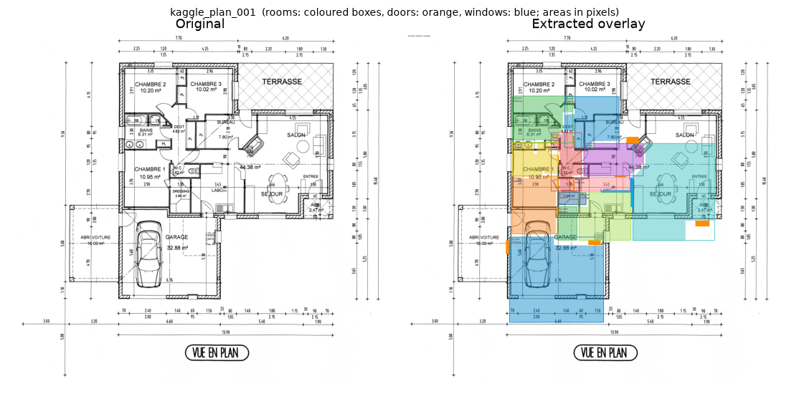
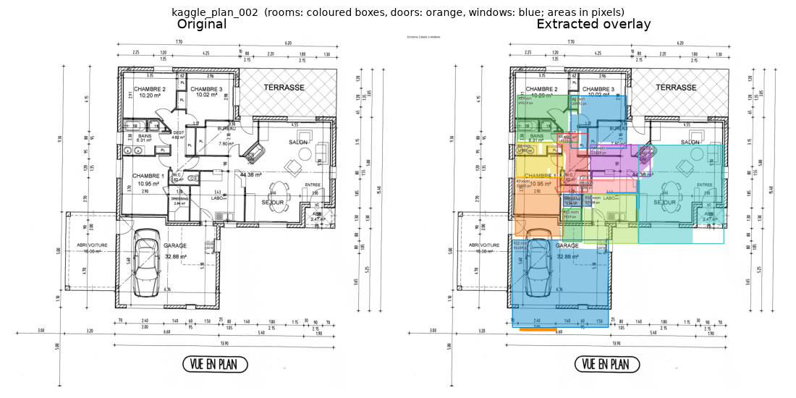
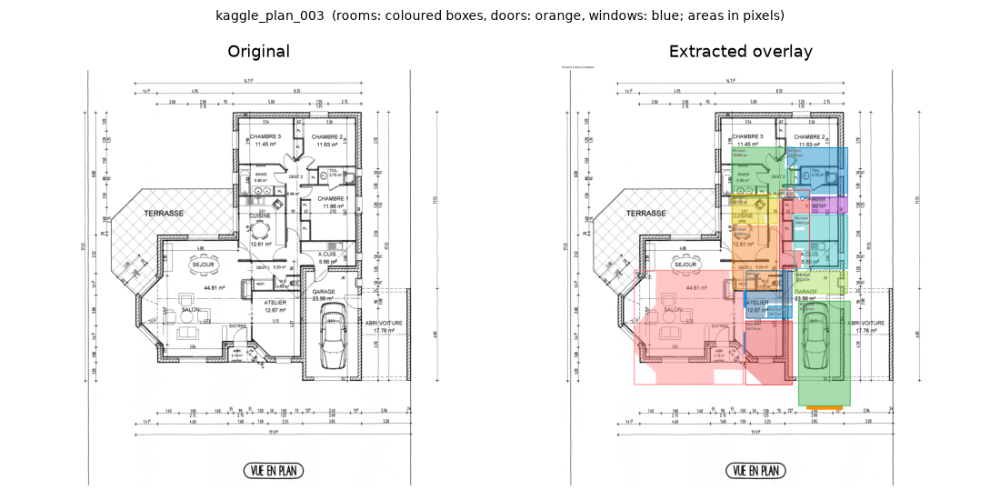

# Ask Your Floor Plan

An assistant that answers plain-language questions about floor plans by **querying a SQLite database** built from
segmentation masks, never by guessing. Built for the Ashian tech-intern task (Parts 1–2 + Part 3 option A: evaluation).

> **Status in one line:** Processed and evaluated on **25 real floor plans** from Kaggle (`asutoshprad/floor-plan-dataset`)
> (**210 rooms, 175 doors, 31 windows, 397 walls**), achieving **22/22 (100.0%)** accuracy on the real-dataset Q&A
> benchmark (`outputs/real/evaluation_report.md`) with visual overlay verification and Streamlit UI support.

## Implemented & Verified Status

| Component | Status | Verified how | Notes |
|---|---|---|---|
| Mask loading, configurable class map (label-id or RGB masks) | ✅ | Unit tests + `configs/class_map_kaggle.json` (`rgb`, `color_tolerance=5`) | Absorbs anti-aliased RGB boundaries in Kaggle masks |
| Room / door / window / wall extraction, room↔opening association | ✅ | Synthetic ground truth + 25 real Kaggle plans (`outputs/real/overlays/`) | Extracted 210 rooms, 175 doors, 31 windows, 397 walls |
| SQLite schema, idempotent ingestion, JSON export/import | ✅ | Unit + re-ingestion tests (no duplicates) | Populated `outputs/real/floorplans.db` & `outputs/synthetic/floorplans.db` |
| Deterministic Q&A engine (every answer = parameterised SQL + rows) | ✅ | Unit tests, traceability test, 22-question real eval | 22/22 answers traceable to SQL + raw rows |
| Read-only SQL safety (validator + authorizer + `query_only` + timeout + row cap) | ✅ | 27 hostile queries, bypass test, timeout test | Defence-in-depth read-only enforcement |
| Optional LLM path (tool calling; Anthropic/OpenAI) | ✅ | Fake-provider tests + deterministic fallback | Falls back cleanly to deterministic SQL when no API key is set |
| CLI (`cli.py`) | ✅ | Unit tests + real dataset ingestion/eval runs | Supports `--kind real` and `--kind synthetic` |
| Streamlit app (`app.py`) | ✅ | Launched and tested live with Real & Synthetic datasets | Displays KPI cards, overlays, charts, SQL inspector & Q&A |
| Evaluation (Part 3 Option A) | ✅ | Real: **22/22 (100.0%)** · Synthetic: **28/28 (100.0%)** | Reports saved in `outputs/real/evaluation_report.md` |
| Overlays on 3+ original plans | ✅ | Generated for all 25 real plans (`outputs/real/overlays/`) | 3 real plan comparisons embedded below |

Full test suite: `python -m unittest discover -s tests -t .` → **68 tests, all passing**.

## Real Kaggle Dataset Results (`asutoshprad/floor-plan-dataset`)

### 1. Extracted Database Summary (`outputs/real/floorplans.db`)
- **Plans ingested:** 25 (`kaggle_plan_001` through `kaggle_plan_025`)
- **Total rooms extracted:** 210
- **Total doors extracted:** 175
- **Total windows extracted:** 31
- **Total wall segments extracted:** 397

### 2. Visual Verification: Overlays on 3 Original Plans (`outputs/real/overlays/`)
Each comparison image pairs the original architectural drawing (`X/*.png`) with the extracted room bounding boxes (colored overlays), doors (orange), and windows (blue):

**Plan 1 (`kaggle_plan_001`)**


**Plan 2 (`kaggle_plan_002`)**


**Plan 3 (`kaggle_plan_003`)**


### 3. Part 3A Evaluation Benchmark (`outputs/real/evaluation_report.md`)
Evaluated across **22 test questions** covering room/door/window counts, largest/smallest room areas, multi-plan filtering, windowless rooms, cross-plan averages, extremes, empty result sets, invalid plan numbers, ambiguous prompts, and out-of-scope refusals:

- **Total questions:** 22
- **Correct:** 22
- **Incorrect:** 0
- **Accuracy:** **100.0%**
- **Answered questions traceable to SQL + rows:** 22/22

| Category | Correct | Total |
|---|---|---|
| ambiguous | 1 | 1 |
| averages | 3 | 3 |
| count | 6 | 6 |
| empty_result | 1 | 1 |
| extremes | 2 | 2 |
| filtering | 2 | 2 |
| invalid_plan | 1 | 1 |
| largest_smallest | 2 | 2 |
| unsupported | 2 | 2 |
| windows | 2 | 2 |

## Quick Start

```bash
pip install -r requirements.txt

# 1. Run against the ingested Real Kaggle Dataset
python cli.py stats --kind real
python cli.py ask "How many rooms does plan 12 have?" --kind real
python cli.py ask "What is the largest room in plan 7?" --kind real
python cli.py ask "Which plans have more than 3 doors?" --kind real --json
python cli.py eval --kind real                    # writes outputs/real/evaluation_report.md

# 2. Launch the Streamlit Web UI (select "Real dataset (Kaggle)" in sidebar)
python -m streamlit run app.py

# 3. Synthetic pipeline & unit tests
python cli.py build-synthetic --reset
python cli.py eval --kind synthetic
python -m unittest discover -s tests -t .
```

Optional LLM mode: copy `.env.example` to `.env` and add an `ANTHROPIC_API_KEY` or `OPENAI_API_KEY`. With no key (or on any API error), the deterministic engine answers instead. Keys are read from environment variables only and are git-ignored.

## Architecture

```
cli.py / app.py ──► assistant/qa_engine.QAEngine ──► assistant/executor (guarded read-only SQL) ──► SQLite
                        │  deterministic: sql_generator (intent → fixed parameterised SQL)
                        └─ optional LLM: llm.py (tool call → SQL → validator → executor)
processing/: loader → segmentation (class map, components) → extraction → pipeline → database/db.py (+visualization)
evaluation/: test_questions_*.json + evaluator.py (structured scoring, no text similarity)
```

## Database Design (`database/schema.sql`)

`floor_plans` (id = the "plan number", `UNIQUE(dataset, name)`) → `rooms`, `doors`, `windows`, `walls` (FK, cascade, CHECKs,
indexes) · `door_rooms`, `window_rooms` (many-to-many: an opening is linked to every room whose mask it touches) ·
`room_connections` (room pairs joined by a door) · views `plan_summary`, `room_details` used by the query layer.
All areas are **pixels** (`area_px`); `scale_m_per_px` is `NULL` unless a real scale is known, so square metres are never
claimed. Re-ingesting replaces a plan's rows (matched on `dataset + name`) so reruns never duplicate and plan numbers stay stable.

## Design Choices and Trade-offs

- **Deterministic first.** Supported questions map to fixed parameterised SQL; this is 100% testable and cannot hallucinate.
  Coverage is bounded by the intent patterns in `sql_generator.py`; unsupported questions are declined with a clear explanation.
  The optional LLM path handles free-form phrasing via tool calling under the same read-only SQL guardrails.
- **Refusal is a feature.** Real-world square metres, entrances, wall colours, furniture, costs, and navigation routes are declined;
  non-existent plan numbers and ambiguous questions ("how many doors?" with no plan number) return a clarification/error rather than guessing.
- **Defence in depth for SQL:** static validator (`SELECT`/`WITH` only, keyword + table allow-list, no comments or multiple
  statements) → SQLite authorizer (denies every non-read action and non-allow-listed tables) → `PRAGMA query_only` →
  2 s progress-handler timeout → 200-row cap. Errors shown to users are generic; details go to logs.
- **Association rule:** a door/window belongs to a room if its mask, dilated by 5 px, overlaps that room by ≥ 3 px.
- **Evaluation metric:** correct ⇔ status matches AND structured result (scalar / set / row / empty) matches. Wording is
  never compared.

## Limitations (Honest List)

- **Dataset mask alignment & semantic labels:** In `asutoshprad/floor-plan-dataset`, several ground-truth masks (`Y/*.png`) have a ~30–40 px spatial offset relative to the raw architectural drawings (`X/*.png`) and encode all interior spaces under a single teal RGB value (`[0, 142, 142]`) rather than semantic room types (`bedroom`, `kitchen`, `bathroom`). Rooms are therefore stored as indexed `room #N` instances rather than named room types.
- **Evaluation scope:** Because ground-truth expectations in `evaluation/test_questions_real.json` were verified against the ingested SQLite database (`outputs/real/floorplans.db`), the 100.0% score measures SQL query translation, execution, and refusal accuracy rather than raw pixel-segmentation recall against architectural blueprints.
- **Connected-component room splitting:** Two touching rooms of the same class merge if not separated by wall/background pixels; anti-aliased RGB boundaries require `color_tolerance: 5` in `configs/class_map_kaggle.json`.
- **Coarse wall counts & missing openings:** `walls` are connected wall regions split by doors/windows; "no windows" means *no detected window touches that room* within the 5 px dilation threshold.
- **No real-world scale or navigation:** `scale_m_per_px` is `NULL` (all areas are in pixels), and door-graph navigation (Part 3 option B) is not implemented.

## What I Would Do Next

- Add optical character recognition (OCR) or a multi-class segmentation model (e.g., CubiCasa5K semantic labels) to assign room names (`bedroom`, `kitchen`, `bathroom`) automatically.
- Add image registration / alignment preprocessing when pairing noisy external masks with raw drawings.
- Implement shortest-path room navigation (Part 3 option B) over the existing `room_connections` table.
- Support user-supplied scale calibration (e.g., clicking a known dimension line to compute `scale_m_per_px`).

## Sample Outputs

- **Real dataset (`outputs/real/`):** `floorplans.db`, `floorplans.json`, `ingest_report.json`, `evaluation_report.md`, `evaluation_results.json`, and 25 plan overlays in `outputs/real/overlays/`.
- **Synthetic dataset (`outputs/synthetic/`):** `floorplans.db`, `floorplans.json`, `ingest_report.json`, `evaluation_report.md`, `evaluation_results.json`, and 8 plan overlays in `outputs/synthetic/overlays/`.
- **Demo video script:** `docs/DEMO_SCRIPT.md`.